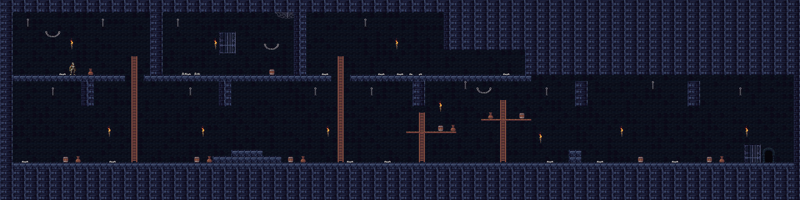
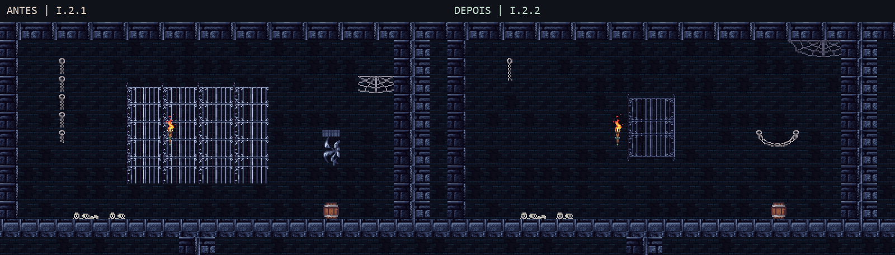
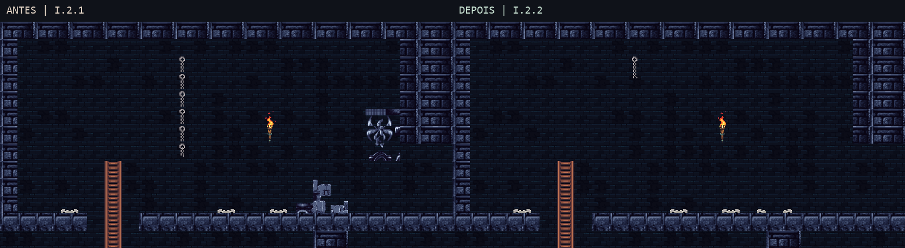
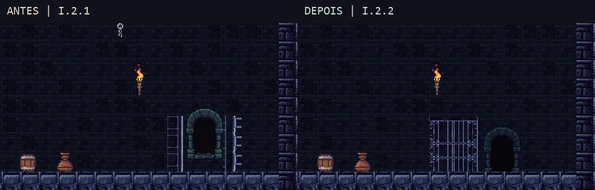
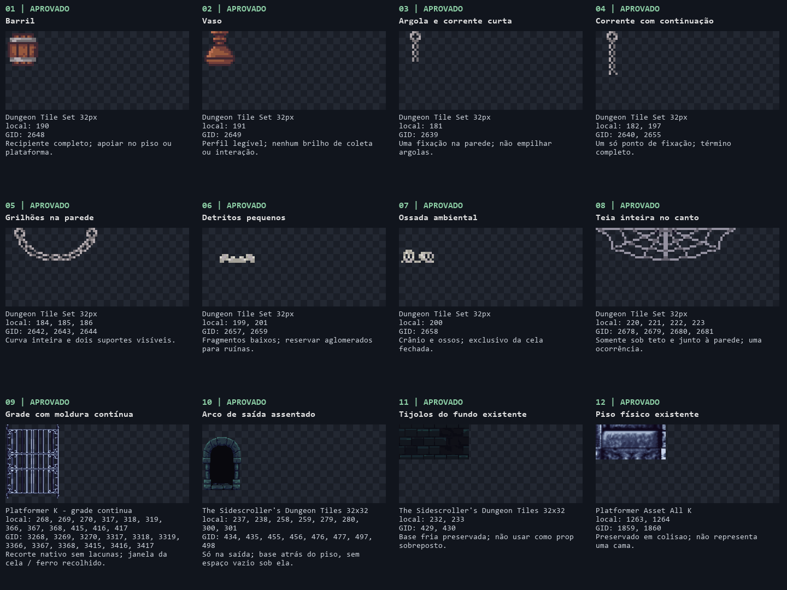
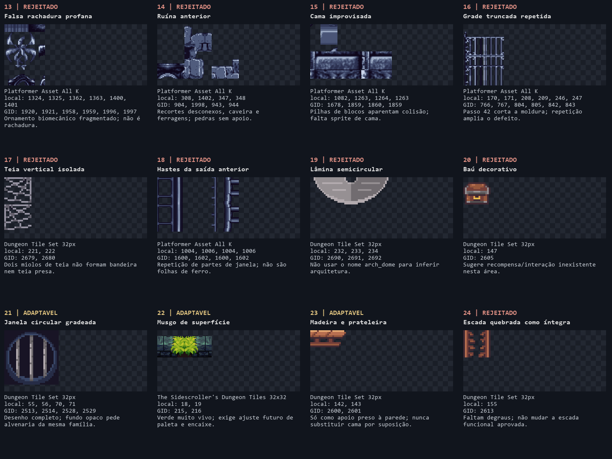

# PROFANE ECHO — Fase I.2.2: Curadoria Visual e Auditoria de Tilesets

Data: 22/11/2026. **Curadoria concluída, com estrutura jogável preservada.**

Foram inspecionadas as 45 imagens de cenário, os oito TSX anteriores e o ZIP de objetos. Os 29 PNGs do ZIP são cópias dos arquivos extraídos. Nenhum pack foi baixado; nenhuma imagem de asset foi criada ou alterada. O novo TSX contém apenas metadados de recorte de uma imagem existente.

## Resultado e capturas









Outras comparações com enquadramento idêntico: [spawn](previews/i22/comparativo_cela_spawn.png), [passagem opcional](previews/i22/comparativo_passagem.png), [corredor oeste](previews/i22/comparativo_corredor_oeste.png), [galeria](previews/i22/comparativo_galeria.png), [corredor leste](previews/i22/comparativo_corredor_leste.png).

[Antes completo](previews/i22/antes_completo.png) · [Depois completo](previews/i22/depois_completo.png) · [Saída no jogo](previews/i22/jogo/07_saida.png) · [Exportação do Tiled](previews/i22/tiled.png).

Para revisar: `python main.py --teste-celas`.

## Auditoria visual do acervo

Foram consultados o catálogo e a auditoria I.0, a [referência conceitual](referencias/fase_1%28celas%29.png), o TMX atual, capturas I.2 em `previews/i2/` e revisões em `previews/i2_audit/`. Não havia relatório I.2.1 separado. As imagens “antes” desta entrega foram renderizadas do TMX recebido, pois o gerador e algumas capturas históricas já divergiam dele.

As seis pranchas abaixo cobrem todas as imagens, inclusive as não integradas. O [inventário JSON](previews/i22/inventario.json) contém caminhos, dimensões, pixels com alpha não nulo e SHA-256 por PNG:

[01: tijolos e primeiros props](previews/i22/inventario_01.png) · [02: suportes, caixas e ferragens](previews/i22/inventario_02.png) · [03: portas, cercas e correntes](previews/i22/inventario_03.png) · [04: recipientes, ossada e teias](previews/i22/inventario_04.png) · [05: escadas e folhas Dungeon](previews/i22/inventario_05.png) · [06: Platformer, Sidescroller e tochas](previews/i22/inventario_06.png).

| Fonte | Arquitetura, celas e objetos | Transparência, paleta e combinação |
|---|---|---|
| The Sidescroller's Dungeon Tiles 32x32 | Tijolos, arcos completos, portas, colunas, vasos, bandeiras, ruínas e musgo | Mistura arquitetura opaca com silhuetas transparentes. Pedra verde-azulada: usar pontualmente. O arco é adequado na saída, assentado no piso; não em portas falsas pelo corredor. |
| Platformer Asset All K | Pedra fria, grades e ruínas; também ornamentos, tecnologia, formas orgânicas e caveiras | Alpha varia. Estilo mais detalhado; selecionar motivos completos. Recortes com transparência não são automaticamente móveis ou rachaduras. |
| Dungeon Tile Set 32px | Tijolos, janela gradeada, porta de madeira, correntes, barris, vasos, ossada, detritos, teia e prateleiras | Props legíveis e ocres compatíveis com as escadas. Janelas e alguns blocos têm fundo opaco de outra cor; não sobrepor como adesivos. Principal família dos pequenos objetos mantidos. |
| Dungeon Tile Set.png | Mesmos motivos na folha menor 240×288 | Não acrescenta itens ausentes. Preferir a versão 32px já integrada. |
| parede_variantes / chao_variantes | Variantes de tijolos e piso, sem móveis ou ferragens | Opacos, cinza-azulados. Servem à estrutura, não a camas improvisadas. Não alterados. |
| Dungeon Bricks Plain / Shadow | Tijolos roxos; nenhuma grade ou mobília | Folhas incluem faixa de créditos que não é tile. Paleta e escala diferentes; não incorporadas. |
| decoracao_tileset | Suporte e três recortes de escada | Alpha adequado, mesma família Dungeon; já há equivalentes integrados. |
| decoracao_tileset_1 | Cerca, gaiola, teia, correntes, barril e vaso | Folha de objetos com posicionamento próprio; não presumir que todo recorte 32×32 esteja completo. |
| tileset_decoracao_dungeon_32px | Reúne os objetos Dungeon com margens diferentes | Nome “32px” não garante alinhamento uniforme. Preferir os recortes conhecidos no TSX integrado. |
| escada_base / meio / topo | Escada; o meio tem degraus ausentes | Alpha adequado, ocre. Não trocar a escada funcional por aparência quebrada. Camada preservada. |
| tileset.png | Fundo verde saturado e tochas | Fundo destoa da prisão fria. Há folha específica melhor para as tochas. |
| Torch Sprite Sheet 32x64 | Chama e haste, variantes fraca/forte | Alpha adequado e acento quente discreto; entidades existentes preservadas. |

### Os 29 recortes individuais não integrados

Arquivos em `Dungeon_Tileset_Items_32px/tileset_items/`; dimensões frequentemente não múltiplas de 32. Sem TSX próprio, não possuem GID. O inventário fornece a origem exata; os equivalentes integrados têm IDs no catálogo seguinte.

| Arquivos | Parecer visual |
|---|---|
| 01_ladder; 02/03_plank_bar; 04_wall_bracket_shelf | Escada, travessas e apoio reconhecíveis. Prateleiras precisam de apoio e não são camas. |
| 05_hatch_trapdoor; 06/07_chest; 08_key | Sugerem mecanismos, recompensa ou coleta inexistentes. Não usar como decoração inerte. |
| 09/10_torch_bracket; 11_wall_sconce; 13/14_hook_nub | Ferragens adaptáveis, desde que completas; alguns recortes incluem partes vizinhas. |
| 12_door_barred | Porta de madeira legível; não representa ferro aberto. |
| 15_fence_ornate; 17_fence_plain | Cercas baixas, não painéis altos de cela. Não repetir verticalmente para inventar uma grade. |
| 16_lantern_hanging | Parece gaiola sem chama, apesar do nome “lantern”. |
| 18/19/20_chain_pendant; 21_chain_swag | Correntes e grilhões completos; usar uma fixação por objeto. |
| 22_vase_large; 23_barrel | Recipientes adequados; equivalentes integrados mantidos. |
| 24_rubble_A; 25_rubble_B | O primeiro inclui crânios/ossos; o segundo é detrito. Separar ossada de entulho genérico. |
| 26_spiderweb | Teia horizontal completa, apropriada num canto; não em tiras verticais soltas. |
| 27/28_arch_dome; 29_border_strip | Silhuetas de lâminas semicirculares e espinhos, não arcos ou molduras inofensivas. |

## Catálogo de candidatos com IDs

**12 aprovados, 9 rejeitados neste contexto e 3 adaptáveis.** Aprovação depende da função, montagem e posição. O quadriculado mostra transparência e não faz parte do sprite.





[Catálogo CSV](previews/i22/catalogo.csv) · [JSON com matrizes completas](previews/i22/catalogo.json). IDs locais começam em zero; GIDs pertencem a este mapa, não são universais.

### Grade contínua

O [novo TSX](../../assets/tileset/tilesets/Platformer%20K%20-%20grade%20continua.tsx) referencia o mesmo PNG Platformer K. O TSX geral usa passo 42 (32+10), que corta partes internas desse portão composto. O novo usa margem 20 e passo 32 para preservar o recorte nativo **(756,180,96,128)**.

Firstgid 3000; IDs locais `268–270,317–319,366–368,415–417`; GIDs `3268–3270,3317–3319,3366–3368,3415–3417`. Nenhum PNG, TSX antigo ou firstgid existente foi alterado. Somente essa composição está aprovada; os outros recortes técnicos do novo TSX não receberam aprovação automática.

## Ocorrências e correções

O [CSV por ocorrência](previews/i22/ocorrencias.csv) registra todas as **212 células ocupadas** da decoração recebida: camada, coluna, linha, pixels, tileset, ID local, GID, decisão, motivo e destino. O [diff completo](previews/i22/alteracoes.csv) também inclui inserções em células vazias.

Classificação por célula: **41 MANTER, 129 SUBSTITUIR, 42 REMOVER**. A decoração final ocupa 113 células: 77 em `decoracao`, 36 em `decoracao_fundo`. Há 216 posições alteradas contando remoções, inserções e substituições. Esses números não representam quantidade de objetos compostos.

Coordenadas seguintes em coluna/linha base zero; multiplicar por 32 para obter pixels. Para cada tile individual, consultar o CSV.

| Elemento | Camada / região anterior | Origem, GID / ID local | Decisão |
|---|---|---|---|
| Cama improvisada | decoracao (5–7,10–11) | Platformer K: 1678/1082,1859/1263,1860/1264 | REMOVER: pilha parece bloco sólido; não há cama convincente. |
| Correntes repetidas | decoracao; x=4,16,28,58 nas celas; x=8,30,50,59,74,87,104,118 no corredor | Dungeon: 2639/181 e 2641/183 | SUBSTITUIR por corrente inteira 2640/182 + 2655/197, conservando a fixação superior. |
| Grade gigante | decoracao (32–39,4–9) | Platformer K: G766,767,804,805,842,843; locais170,171,208,209,246,247 | SUBSTITUIR por grade contínua em decoracao_fundo (35,5), 3×4 tiles, como grade fixa da cela fechada. |
| Falsas marcas | decoracao (43,7–8) | Platformer K: 1920/1324,1958/1362 | SUBSTITUIR por grilhões Dungeon G2642–2644/L184–186 em (42–44,7). Não apresentados como marcas de dias. |
| Teia incompleta | decoracao, região (44–47,3–4) | Dungeon G2679/2680, locais221/222 | SUBSTITUIR por teia completa G2678–2681 junto ao teto em decoracao_fundo (44–47,2). |
| Falsa fissura | decoracao_fundo (69–70,6–8) | Platformer K G1920,1921,1958,1959,1996,1997; locais1324,1325,1362,1363,1400,1401 | REMOVER: ornamento biomecânico, sem substituto convincente. |
| Ruína desconexa | decoracao (65–67,10–11) | Platformer K:904/308,1998/1402,943/347,944/348 | SUBSTITUIR por detritos Dungeon2657/199 e2659/201 no piso (65,11)/(67,11). |
| Teias verticais | decoracao (39,15–16),(96,15–16),(115,15–16) | Dungeon2679/221 e2680/222 | REMOVER: não formam bandeira nem teia apoiada. |
| Arcos falsos do corredor | decoracao (15–16,22–25),(57–58,22–25),(104–105,22–25) | Sidescroller G434,435,455,456,476,477,497,498; locais237,238,258,259,279,280,300,301 | REMOVER: sugerem portas utilizáveis onde não existe passagem. |
| Saída suspensa | decoracao (121–125,22–25) | Arco Sidescroller acima; hastes Platformer1600/1004,1602/1006 | SUBSTITUIR: arco em decoracao_fundo (122,23), base atrás do piso, grade íntegra recolhida ao lado em (119,23). |
| Vaso além da plataforma | decoracao (85,18) | Dungeon2649/191 | SUBSTITUIR posição: mesmo sprite em (78,18), apoiado. |
| Detritos repetidos no alcove | decoracao (82–83,11) | Dungeon2657/199,2659/201 | REMOVER; manter conjunto de (80,11). |
| Recipientes, ossada e detritos restantes | decoracao; coordenadas exatas no CSV | Dungeon2648/190,2649/191,2657/199,2658/200,2659/201 | MANTER: reconhecíveis, apoiados e sem falsa interação. |

Nichos opacos retirados anteriormente não foram restaurados. Foram acrescentados grilhões completos na cela inicial e uma corrente de manutenção na galeria. A saída continua visual e reservada à integração futura, sem trigger ou prompt novo.

## Coerência e lacunas reais

A cela inicial prioriza espaço livre, recipiente e confinamento por correntes. A cela fechada reúne grade enquadrada, ossada, grilhões, barril e uma teia apoiada. A destruída tem detritos localizados, sem símbolos mecânicos ou peças suspensas. O corredor mantém tochas e poucos props legíveis. A galeria tem recipientes efetivamente sobre as travessas. A passagem opcional fica discreta até existir uma rachadura adequada.

| Elemento | Classificação | Evidência / limite |
|---|---|---|
| Paredes e piso | Já disponível | Famílias completas; arquitetura atual preservada. |
| Barris, vasos, correntes e grilhões | Já disponível | Dungeon, IDs no catálogo. |
| Ossada ambiental | Já disponível | G2658; pilha de ossos, não esqueleto sentado. |
| Escombros pequenos | Já disponível | G2657/G2659, apoiados no piso. |
| Teia e arco completos | Já disponível | Exigem montagem e apoio adequados. |
| Grade de cela / painel de ferro | Adaptável — aplicado | Recorte contínuo do desenho já existente, sem criar pixels. |
| Janela gradeada circular | Adaptável | Desenho completo, porém fundo opaco pede arquitetura da mesma família. |
| Ferragens e prateleiras | Adaptável | Há peças completas; precisam de montagem funcionalmente legível. |
| Alvenaria grande quebrada | Adaptável | Existem ruínas nas folhas grandes; selecionar composição completa, não recortes aleatórios ou falsos blocos físicos. |
| Musgo / umidade | Adaptável | Musgo verde muito vivo no Sidescroller exige ajuste futuro autorizado. Não há boa poça/mancha pronta na paleta atual. |
| Cama de pedra de prisioneiro | Ausente | Blocos e plataformas não formam uma cama convincente. Removida a improvisação. |
| Esqueleto sentado sem arma | Ausente no acervo de cenário | A ossada atende ao abandono, mas não à pose conceitual. |
| Marcas de contagem de dias | Ausente | Nenhum desenho claro identificado; não substituir por símbolos abstratos. |
| Rachadura com Eco Profano discreto | Ausente | Ornamentos e bordas de ruína não equivalem à fissura ramificada da referência. |
| Porta de ferro aberta em perspectiva | Ausente como sprite pronto | Painel deslocado junto ao arco é composição adaptada; não há animação de abertura. |

Ausências não autorizaram downloads ou criação de arte nesta etapa. Espaço livre é preferível a outro substituto ambíguo.

## Fonte de verdade e preservação

**O TMX editado diretamente no Tiled é a fonte de verdade.** O gerador recebido já divergia do mapa. `scripts/gerar_bloco_celas.py`, inclusive sua função `gerar()`, agora somente valida e não grava nenhum arquivo. Não existe opção de regeneração que restaure a decoração antiga.

[TMX anterior integral](previews/i22/bloco_celas_antes.tmx.txt) e [gerador anterior](previews/i22/gerador_antes.py.txt) foram preservados como texto, antes das alterações. São evidências históricas, não fontes alternativas executáveis. O [baseline](previews/i22/baseline.json) e a [conferência final](previews/i22/preservacao_final.json) registram sete elementos protegidos e 60 arquivos anteriores intactos.

Nesta etapa não foram editados main.py, game_scene.py, tile_map.py, niveis.py, mapas antigos, imagens originais ou TSX antigos. As alterações anteriores do workspace foram preservadas. Objetos de gameplay, HUD, áudio, saves, inventário e progressão não foram modificados.

## Validação

| Verificação | Resultado |
|---|---|
| TMX/TSX/PNG/GIDs/camadas | Zero erros e avisos no validador |
| Física aprovada | 1781 sólidos, 16 plataformas, 52 células de escada; camadas e atributos idênticos ao baseline |
| Fundo, objetos e referências | Idênticos ao baseline, incluindo spawns e tochas |
| Arquivos originais | 60 hashes anteriores sem diferenças |
| Percurso real | 3290 frames, oito marcos, entrada/desvios/saída/retorno; sem teletransporte ou dash |
| Câmera e renderer | Capturas por região e durante o percurso; testes existentes de zoom preservados |
| Rasterizador Tiled | Exit code 0; mapa e novo TSX renderizados |
| Proteção do gerador | Bytes e mtime do TMX não mudam ao executar o comando legado |
| Suíte completa | 297 testes passaram; log abaixo |
| git diff --check | Sem erros; avisos LF/CRLF em arquivos já modificados no workspace |

[Log do pytest](previews/i22/pytest_completo.txt) · [Percurso JSON](previews/i22/jogo/percurso.json) · [Spawn no jogo](previews/i22/jogo/01_spawn.png) · [Retorno](previews/i22/jogo/08_retorno.png).

Permanece um aviso libpng de perfil sRGB preexistente, sem falha de carregamento; os PNGs não foram regravados. Testes demonstram preservação funcional, não substituem a avaliação estética do usuário.

## Recomendações e reprodução

Para próximas áreas: conferir a imagem real antes do nome do arquivo; usar motivos completos e registrar IDs/montagem; manter Dungeon como família principal de pequenos props e Platformer K pontualmente; conferir apoios em escala de jogo; reservar portas, baús e chaves a funções reais. Priorizar numa futura criação autorizada cama, marcas de dias, umidade e rachadura profana.

```powershell
python scripts/auditar_celas_i22.py --estado depois
python scripts/catalogar_tiles_i22.py
python scripts/gerar_bloco_celas.py
python -m pytest --disable-warnings
git diff --check
```

Esses comandos não regeneram o mapa. A opção `--estado antes` foi usada apenas para a fotografia inicial; não repetir sobre a versão final para comparar com a recebida.

**Sem commit ou push. O Antigo Arsenal não foi iniciado.**
