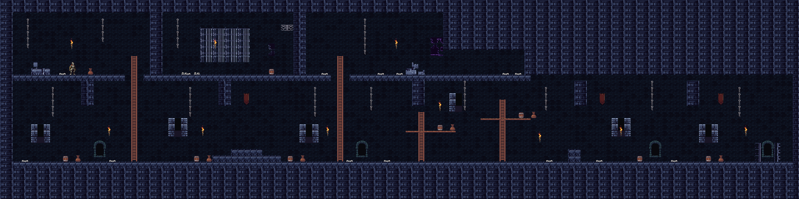
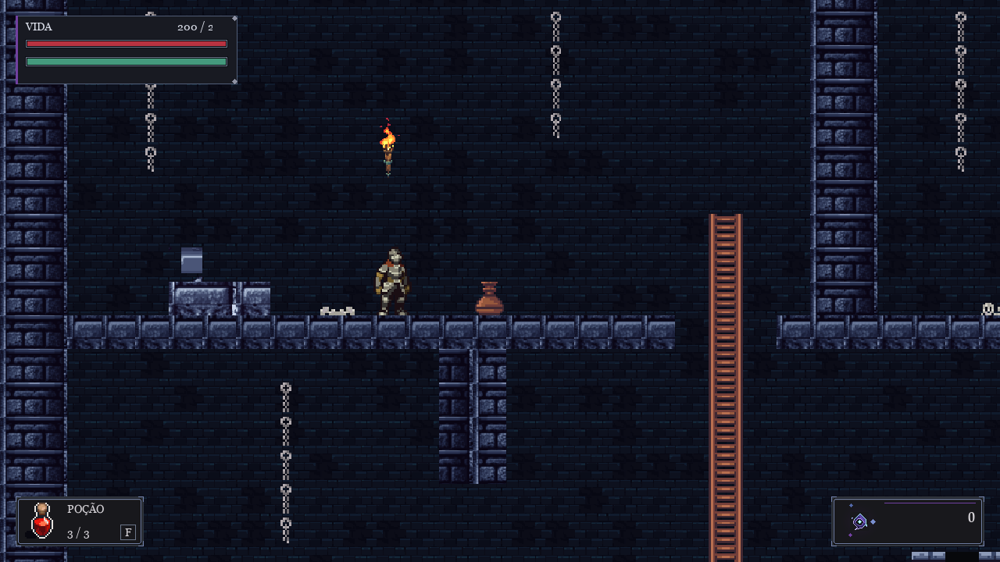
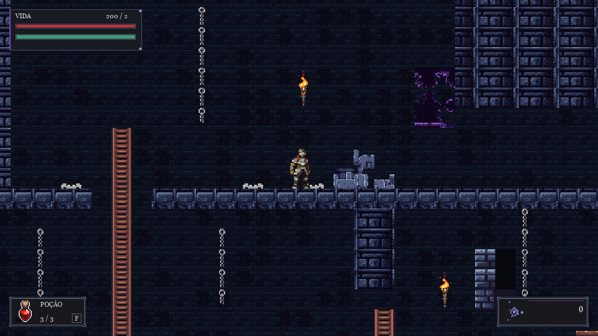
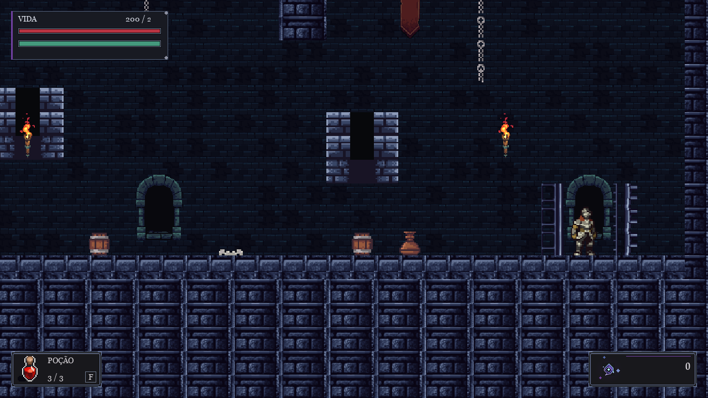

# Fase I.2 — Bloco das Celas Esquecidas

> Histórico da I.2. A decoração e a política de autoria foram revisadas na
> [I.2.2](RELATORIO_FASE_I22_CURATORIA_VISUAL.md). O TMX passou a ser a fonte de
> verdade; `scripts/gerar_bloco_celas.py` agora apenas valida, sem regenerar.

Data: 22/11/2026. Estado: **mapa experimental pronto para revisão visual e funcional**. Não é o início oficial do jogo.

## Executar e revisar

Na raiz do projeto:

```powershell
python main.py --teste-celas
```

Abre diretamente o mapa, sem carregar um slot. A/D movimentam, W/S usam as escadas, Espaço pula, S+Espaço desce pelas plataformas. F3 mostra escadas e plataformas; Esc abre a pausa. Não há sequência de prompts de tutorial.

O modo usa o jogador, HUD, inventário, áudio, câmera e menus existentes. Não associa callback de save, não carrega dados salvos e bloqueia gravações na cena experimental, inclusive chamadas diretas a `salvar`. Ao voltar ao menu, o modo temporário é encerrado e um novo jogo volta a carregar `calabouço_1`. Os flags `--teste-celas` e `--teste-combate` são mutuamente exclusivos.

## Referência e preparação

A imagem conceitual estava disponível em [fase_1(celas).png](referencias/fase_1(celas).png) e foi inspecionada. Foram lidos a auditoria I.0, catálogo, plano de progressão, template, os dois TMX existentes e os carregadores/cena.

A I.1 estava parcialmente implementada no workspace: convenções no template, normalização de `spawn/spwan`, aliases de inimigos e validador. Restavam dois impedimentos ao novo mapa:

- A cena procurava `spwan`, enquanto o carregador já devolvia `spawn`. A cena agora aceita ambos e considera o nome do objeto antes da propriedade `nome`.
- Ecofocos e paredes de boss consultavam `Salas[nome_sala]` incondicionalmente. Essas duas consultas agora aceitam mapas exclusivamente TMX, sem cadastrar uma grade Python fictícia.

As alterações preexistentes em `_template.tmx`, `calabouco_1.tmx`, documentos e outros arquivos foram preservadas. Esta entrega não edita os mapas antigos, `world/niveis.py`, conexões, itens ou formatos de save.

## Dimensões, geometria e direção visual

- Arquivo: [bloco_celas_esquecidas.tmx](../../assets/maps/bloco_celas_esquecidas.tmx).
- **128 × 32 tiles**, tile 32 × 32; mundo **4096 × 1024 px**.
- Janela 1280 × 720, zoom padrão 1,35: área visível aproximada de 948 × 533 px; **4,32 telas horizontais**.
- Orientação orthogonal, vista lateral, mapa finito, CSV sem compressão.
- Piso das celas em y=384; piso principal em y=832. Escadas das celas em x=672 e x=1728, com vãos de 96 px.
- Patamar em x=1088–1440, com incrementos de 32 px. Obstáculo em x=2912, altura 64 px, transponível com pulo comum nos dois sentidos.
- Galeria opcional com plataformas em y=672 e y=608, duas escadas e descida one-way.

A cela inicial contém cama de pedra, correntes, recipiente, pequenos detritos e uma tocha fraca. A cela fechada tem grades, ossada de prisioneiro, marcas de desgaste, teia e um barril. A ossada usa tiles estáticos de crânio/ossos, sem inimigo ou animação de combate; é uma adaptação da figura sentada da referência aos assets existentes. A cela destruída contém alvenaria desmoronada, correntes e a fissura violeta próxima à passagem.

O corredor alterna nichos, contrafortes, depósito elevado, portas antigas ao fundo, galeria de manutenção, obstáculo e vestíbulo final. A paleta usa tijolos escuros azulados, pedras frias nas superfícies físicas, ferragens e pequenos pontos quentes das tochas. Não foram criados PNGs de cenário, atlas, shaders ou iluminação global. A rachadura é uma composição de tiles de ruína existentes com `tintcolor`, sem copiar a imagem conceitual como fundo.

## Tilesets e camadas

Os firstgids do template foram preservados. Apenas três TSX são necessários ao mapa:

| TSX existente | firstgid | Uso |
|---|---:|---|
| The Sidescroller's Dungeon Tiles 32x32 | 197 | Tijolos de fundo, arcos e bandeiras |
| Platformer Asset All K | 596 | Alvenaria, grades, cama, pedras e fissura |
| Dungeon Tile Set 32px | 2458 | Escadas, plataformas, correntes, recipientes, ossada e teias |

As dez tochas são objetos `Tocha` existentes, usando `Torch Sprite Sheet 32x64.png` pelo runtime. O editor mostra seus pontos de objeto; a exportação estática do Tiled não inclui as entidades animadas. As capturas do jogo incluem as tochas.

| Camada | Células/objetos | Função |
|---|---:|---|
| `fundo` | 4096 | Tijolos visuais; tint frio |
| `decoracao_fundo` | 6 | Fissura violeta, sem colisão |
| `escadas` | 52 | Quatro escadas funcionais |
| `plataformas` | 16 | Travessas one-way |
| `colisao` | 1781 | Pisos, limites, paredes e obstáculos |
| `decoracao` | 277 | Props visuais; sem colisão |
| `objetos` | 12 | Dois spawns e dez tochas |
| `referencias` | 8 | Retângulos editoriais ocultos, sem comportamento runtime |

`decoracao_fundo` é uma extensão opcional, desenhada depois de `fundo` e antes de escadas/plataformas/colisão. `decoracao` continua depois da colisão e antes das entidades, como no carregador existente. Não foi adicionado primeiro plano sobre o jogador.

O carregador respeita `tintcolor` local à camada, convertendo a notação Tiled `#AARRGGBB` para RGBA. O efeito é aplicado a uma cópia do recorte; a imagem compartilhada permanece intacta. Camadas sem tint mantêm o comportamento anterior.

## Objetos e propriedades

Coordenadas em pixels, origem superior esquerda. Os spawns são pontos da posição superior esquerda do corpo do jogador, não dos pés. Todos os IDs são únicos.

| ID | Nome/tipo | x, y | Propriedades |
|---|---|---|---|
| 1 | `default` / spawn | 352, 320 | `nome=default` |
| 2 | `direita` / spawn | 3904, 768 | `nome=direita`; reservado ao retorno futuro |
| 3 | tocha_11_6 | 352, 192 | `variante=fraca` |
| 4 | tocha_34_6 | 1088, 192 | `variante=fraca` |
| 5 | tocha_63_6 | 2016, 192 | `variante=fraca` |
| 6 | tocha_17_20 | 544, 640 | `variante=fraca` |
| 7 | tocha_32_20 | 1024, 640 | `variante=fraca` |
| 8 | tocha_52_20 | 1664, 640 | `variante=fraca` |
| 9 | tocha_70_16 | 2240, 512 | `variante=fraca` |
| 10 | tocha_86_21 | 2752, 672 | `variante=fraca` |
| 11 | tocha_99_20 | 3168, 640 | `variante=fraca` |
| 12 | tocha_119_20 | 3808, 640 | `variante=fraca` |

Os objetos abaixo pertencem exclusivamente a `referencias`, tipo `marcador`, com propriedades `descricao` e `estado`. Não disparam eventos nem são carregados como inimigos/portas.

| ID | Nome | x, y | Largura × altura | Estado |
|---|---|---|---|---|
| 13 | cela_spawn | 64, 64 | 704 × 320 | ambiental |
| 14 | cela_fechada | 832, 64 | 672 × 320 | ambiental |
| 15 | cela_destruida | 1568, 64 | 768 × 320 | ambiental |
| 16 | passagem_profana | 2336, 256 | 352 × 128 | planejamento |
| 17 | patamar | 1088, 768 | 352 × 64 | ambiental |
| 18 | galeria | 2080, 512 | 640 × 192 | ambiental |
| 19 | salto | 2912, 768 | 64 × 64 | ambiental |
| 20 | saida_arsenal | 3872, 704 | 160 × 128 | planejamento |

Metadados do mapa: `titulo`, `fase=I.2`, `status=revisao`, `destino_futuro=antigo_arsenal_guardas`. Não são interpretados como conexões ativas.

## Navegação

```text
CELA 1 / SPAWN       CELA 2 FECHADA       CELA 3 DESTRUÍDA <--> PASSAGEM PROFANA
      |                (ambiental)              |
   escada                                     escada
      |                                         |
      +<--> CORREDOR <--> PATAMAR <-------------->+<--> GALERIA <--> SALTO <--> FERRO ABERTO
                                                         |                       |
                                                plataformas opcionais     Arsenal futuro
                                                                         (sem transição)
```

Todos os caminhos jogáveis são reversíveis. A cela fechada é cenário deliberadamente inacessível. A passagem profana tem estrutura explorável, mas não há falsa parede, descoberta ou recompensa implementadas: as mecânicas atuais não fornecem esse ciclo. O caminho principal independe desse desvio e das plataformas superiores.

A saída é uma composição visual de arco e folhas de ferro abertas. Não usa o objeto `porta`, que hoje criaria um bloqueio interativo sem implementar a conexão desejada. O limite direito permanece fechado após o vestíbulo, impedindo sair do mapa de teste. O jogador pode voltar integralmente às celas. A próxima área não foi criada.

## Capturas









- [Mapa completo, 4096 × 1024](previews/i2/bloco_completo.png).
- [Três celas em detalhe](previews/i2/celas_detalhe.png).
- [Corredor](previews/i2/02_corredor.png), [passagem profana](previews/i2/04_passagem_profana.png).
- [Primeira plataforma](previews/i2/05_plataforma.png), [galeria](previews/i2/06_galeria.png), [retorno ao spawn](previews/i2/08_retorno.png).
- [Colisões](previews/i2/colisoes.png): azul=solidez, verde=plataformas, amarelo=escadas.
- [Exportação pelo Tiled](previews/i2/tiled.png), sem entidades de runtime.

## Validação e problemas encontrados

| Verificação | Resultado |
|---|---|
| Abertura no Tiled instalado | OK; janela identificou `bloco_celas_esquecidas.tmx (Profane_Echo) - Tiled` |
| Rasterizador nativo do Tiled | OK, exit code 0, PNG gerado |
| TMX/TSX/PNG, GIDs e camadas | Nenhum erro ou aviso no validador para o novo mapa |
| Recortes das imagens | Todos os GIDs usados carregam surfaces de 32 × 32 |
| Spawn inicial e spawn de retorno | OK; corpo livre de sólidos e apoiado no piso |
| Percurso completo e retorno | OK; 3290 frames simulados, sem reposicionar o jogador |
| Cela destruída e passagem opcional | Visitadas e retorno confirmado |
| Plataformas e escadas | Subida, pouso one-way e S+Espaço confirmados |
| Caminhos impossíveis | Nenhum no percurso validado; sem dash, arma ou combate |
| Câmera/zoom | Limites verificados durante todo o percurso; render testado em 1,0 / 1,35 / 1,8 |
| Isolamento de saves e saída para menu | Testado; sem escrita, fluxo normal restaurado ao sair do modo |
| Suíte completa | **295 passed in 6.42s**; inclui sete testes I.2 |
| `git diff --check` | Sem erros de whitespace |

O percurso usa entradas de teclado simuladas e `Gamescene.atualizar`, com física e câmera reais. Verifica em cada frame que o jogador continua vivo, sem dash, dentro dos limites e sem sobreposição com sólidos. Os seis acionamentos de Espaço incluem quatro saltos e dois drops. O teste não substitui a avaliação humana de ritmo e direção artística.

Evidências: [percurso.json](previews/i2/percurso.json), [saída completa do pytest](previews/i2/pytest_completo.txt).

Problemas resolvidos: incompatibilidade de spawn da I.1 e consultas incondicionais à grade Python; revisão visual dos recortes de escadas e arcos para usar degraus íntegros e porta aberta. Uma tentativa inicial com Qt `offscreen` terminou com erro de inicialização; editor e rasterizador funcionaram com o ambiente gráfico normal. O pygame emite um aviso de perfil sRGB de asset preexistente, sem impedir carregamento ou testes; o PNG original foi preservado.

## Pendências e reprodução

- Aprovação visual e funcional do usuário antes de integrar como início oficial.
- Definir descoberta, eventual parede falsa e recompensa da passagem profana.
- Implementar a conexão bidirecional ao Antigo Arsenal quando essa área existir; spawn de retorno já reservado.
- Tutorial contextual e aquisição da arma em etapa futura. Não há inimigos ativos nesta fase.
- Não foram acrescentados Ecofocos; os existentes permanecem nos mapas atuais. O checkpoint temporário desta cena é o spawn inicial.

```powershell
python scripts/gerar_bloco_celas.py
python scripts/validar_bloco_celas.py --capturas
python -m pytest --disable-warnings
```

O gerador é determinístico e recria apenas o novo TMX. **Regenerar sobrescreve edições manuais feitas nesse TMX**; após editar no Tiled, atualize o gerador ou mantenha o TMX manual como fonte. O validador não altera mapas nem saves. As capturas usam SDL dummy e o renderer real do projeto.

Arquivos de implementação: `main.py`, `core/game_scene.py`, `world/tile_map.py`; novo TMX, gerador, validador de percurso, testes, este relatório e capturas. **Sem commit ou push. Nenhuma próxima área iniciada.**
